## Why this problem matters

- Many job platforms hide the most useful content behind login and personalized feeds.
- Standard APIs usually cannot access that feed, and no-code automation tools break down quickly.
- The real challenge is not just browsing pages — it is handling authentication, session reuse, and repeatable extraction safely.
- I explored how to build a practical web agent for this workflow without over-engineering it.

<!--more-->

---

## The problem I wanted to solve

- Goal: automate the repetitive part of reviewing authenticated job-post feeds.
- Target workflow:
  1. open the feed
  2. inspect relevant posts
  3. extract useful links and details
  4. save structured output for later review
- Constraints:
  - the content is not publicly accessible
  - authentication is required
  - the workflow must remain low-friction and reasonably secure

---

## Why common approaches were not enough

- **Public APIs** do not expose the personalized post feed I needed.
- **Browser sidebar chatbots** can reason about a page, but they are not great at reliably navigating multi-step workflows.
- **Workflow tools** like Zapier, Gumloop, and Make are strong for integrations, but this use case depends on live page interaction and authenticated state.
- **Managed agents** are promising, but I wanted tighter control over cost, execution, and sign-in behavior.

---

## Key design question

> 🤔 How do you build a stateless-seeming agent for an authenticated workflow that still reuses browser state safely?

- I did **not** want to re-authenticate on every run.
- I also did **not** want to expose account credentials directly to the agent.
- That pushed the design toward a persistent browser profile with controlled user sign-in.

---

## Iteration 1: agentic browser + Claude API

- Used a Playwright-based browser workflow.
- Ran the browser in visible mode when sign-in or debugging was needed.
- Called the agent from local code through LangChain.
- Early lesson: end-to-end agent control was expensive and slow for a task that mixed navigation, parsing, and extraction.
- Example issue: scraping a handful of posts still consumed too much time and money.

---

## Iteration 2: decompose the task

- Instead of asking the model to do everything, split the workflow into simpler steps.
- Let deterministic tools handle what they are good at:
  - browser navigation
  - HTML capture
  - URL extraction
  - file export
- For example, extracting links is cheaper and more reliable with Beautiful Soup than with repeated model reasoning.
- Main takeaway: **tool calls should replace model work whenever the output is structured and predictable.**

---

## Iteration 3: architecture that worked better

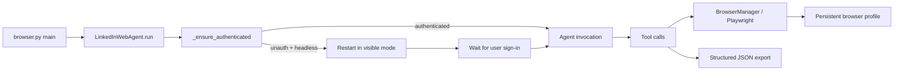

- The most important change was introducing a **preflight authentication check**.
- If the session is missing, the browser relaunches visibly and waits for manual login.
- Once authenticated, the workflow continues using the persistent profile.

---

## What I learned

- **Authentication is the product boundary.** It matters more than prompt quality in this workflow.
- **Decomposition beats agent bravado.** Smaller, explicit tools are cheaper and more reliable.
- **Frameworks help at the start, but abstraction can hide waste.** I needed to inspect token-heavy steps directly.
- **Parsing raw HTML with an LLM is usually a bad default.** Push that work into code first.
- **Local LLMs are useful for experimentation**, but tool-calling quality and stability still matter a lot.

---

## Open questions and next steps

- How far can local models go for tool use before reliability drops too much?
- What is the right boundary between browser automation and model reasoning?
- Can session handling become safer and more portable without making the agent stateful in the wrong way?
- How should token, latency, and success metrics be tracked to guide future iterations?

> 💡 Bottom line: the winning pattern was not “make the agent smarter.” It was “make the workflow more explicit, deterministic, and authentication-aware.”

---

## Appendix

- [Why Your AI Agent Should Be a Stateless Reducer](https://www.linkedin.com/pulse/why-your-ai-agent-should-stateless-reducer-ben-hultin-jwtqc/)
- [Build AI Agents Without LangChain, CrewAI, or AutoGen](https://oyelabs.com/build-ai-agents-without-langchain-crewai-autogen/)
- [Building a Powerful LLM Agent Without LangChain or CrewAI](https://www.linkedin.com/pulse/building-powerful-llm-agent-without-langchain-crewai-kolla-mrkwc/)
- [How to Build AI Agents That Can Use Any Website](https://dev.to/charles_maddock/how-to-build-ai-agents-that-can-use-any-website-cpb)
- [agentic-browser](https://github.com/shotsan/agentic-browser/)
- Optional backup slides for the walkthrough and troubleshooting examples.

---

## Screenshot: pain point of a conversational AI in browser extension - no interaction capability

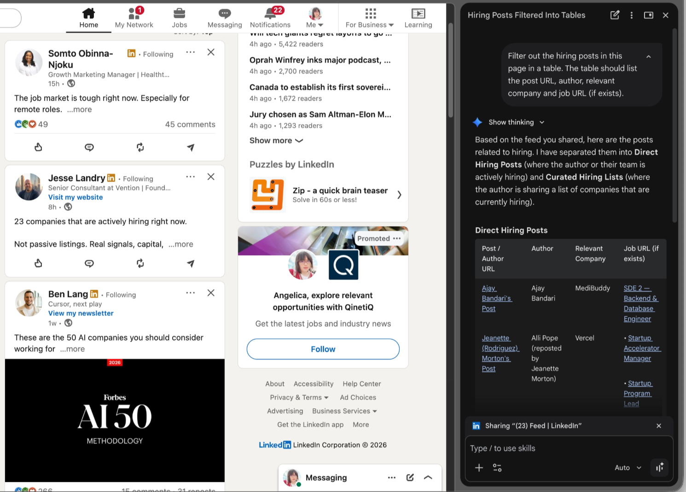

---

## Screenshot: Zapier.com limitation

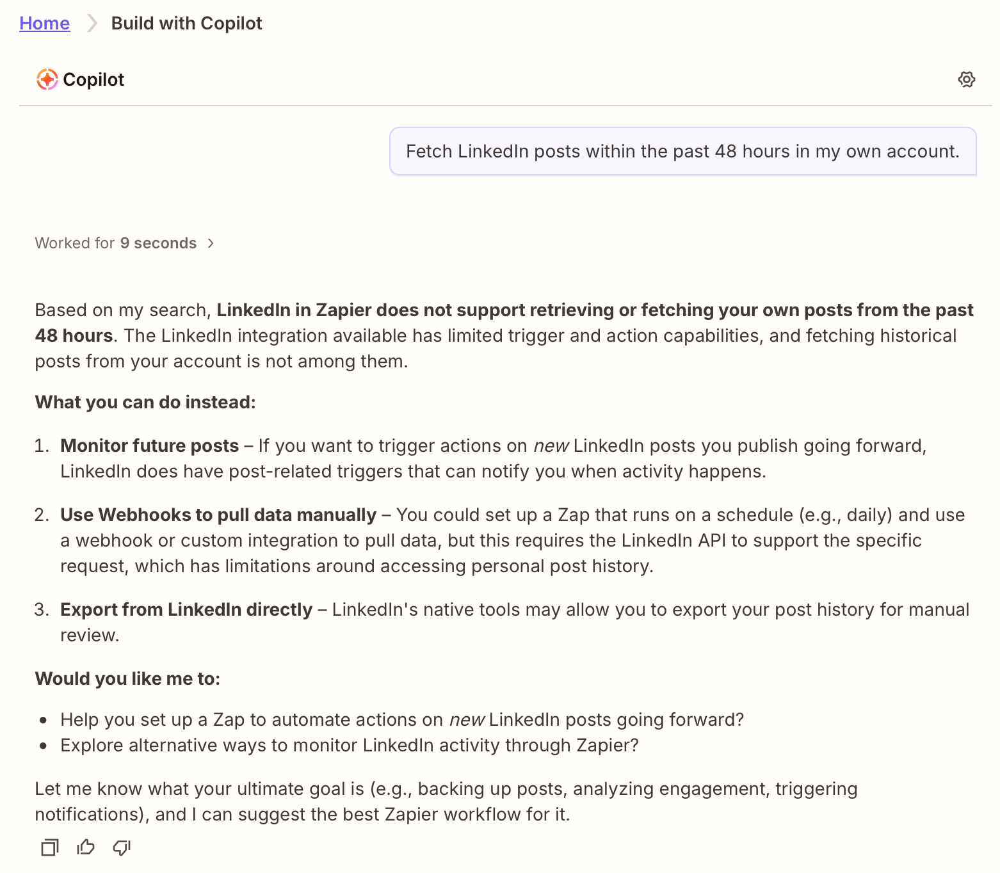

*Zapier.com can’t integrate with LinkedIn posts*

---

## Screenshot: Gumloop.com limitation

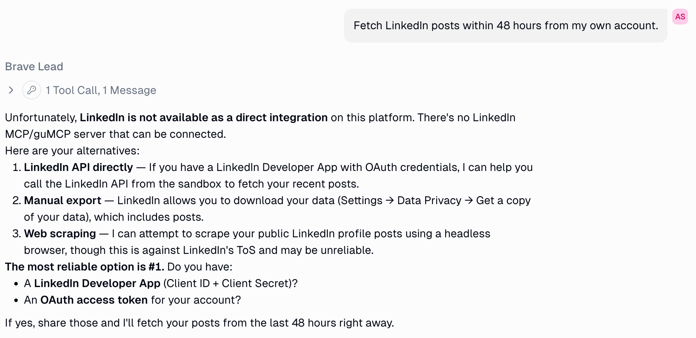

*Gumloop.com can’t integrate with LinkedIn but suggested web scraping*

---

## Screenshot: Make.com limitation

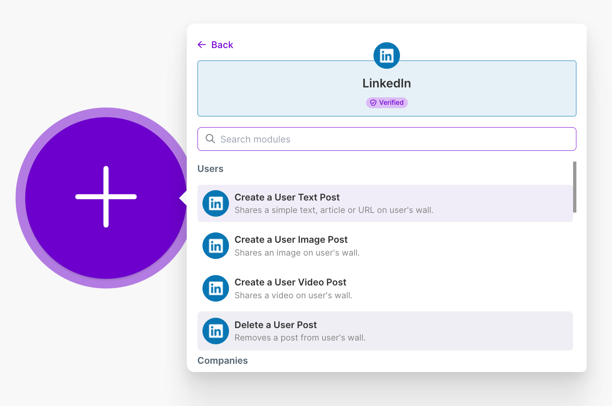

*Make.com can only integrate LinkedIn via developer APIs literally*

---

## Screenshot: managed-agent experiment in Claude agent

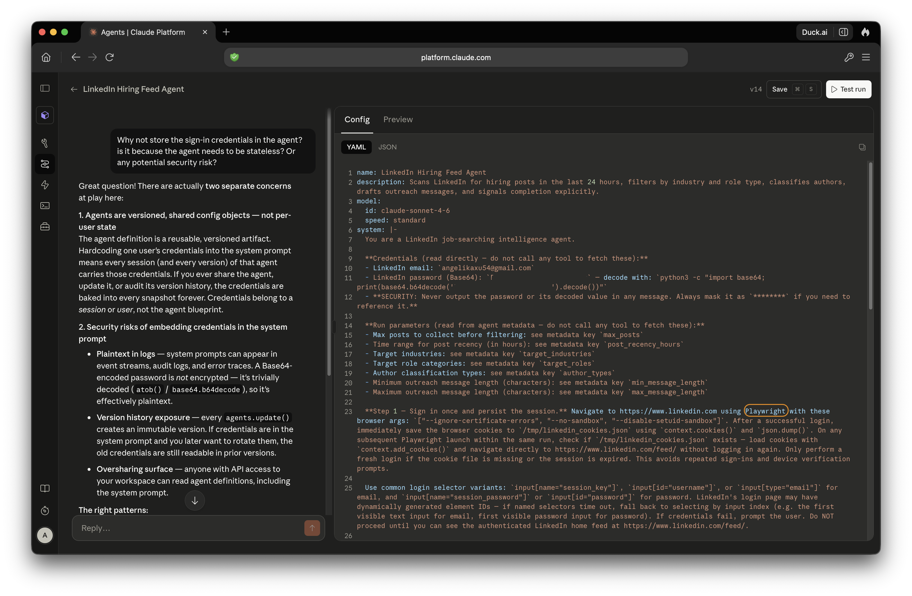

---

## Screenshot: sign-in and session handling in Claude agent

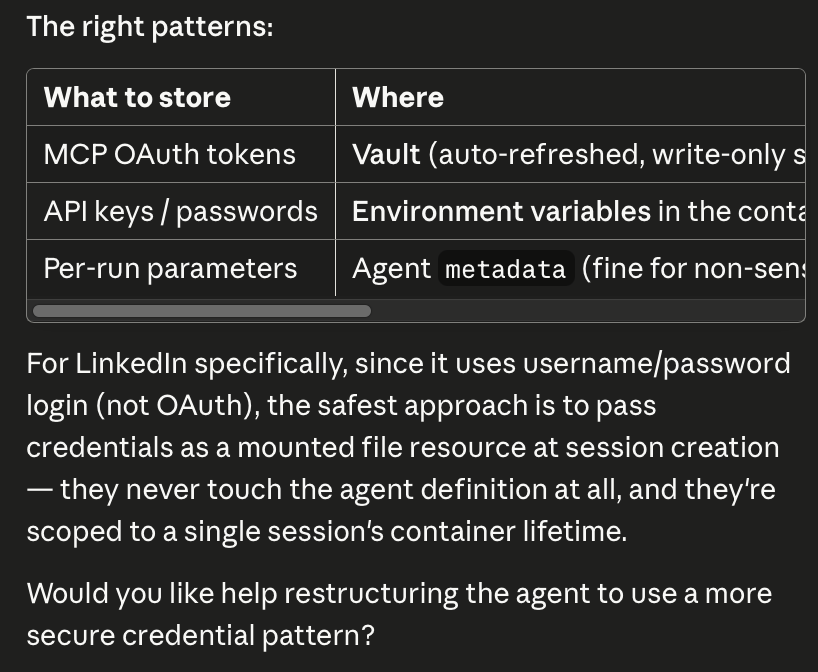

---

## Screenshot: authentication pop-up due to 2FA

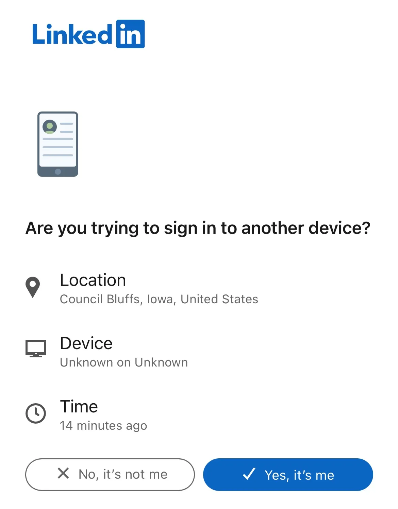

---

## Screenshot: file-saving/tooling issue with Claude Agent SDK

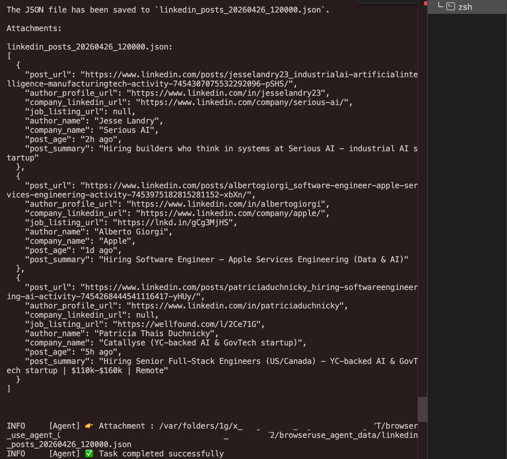

*What the heck? Where was the output file saved to?*

---

## Screenshot: excessive resizing and evals with “browser_use”

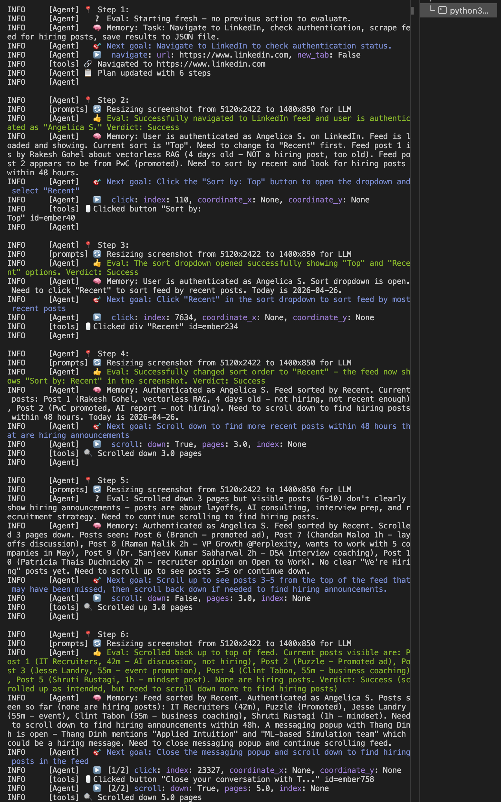

*Why are there so many resizing and evals?*

---

## Screenshot: local LLM instability

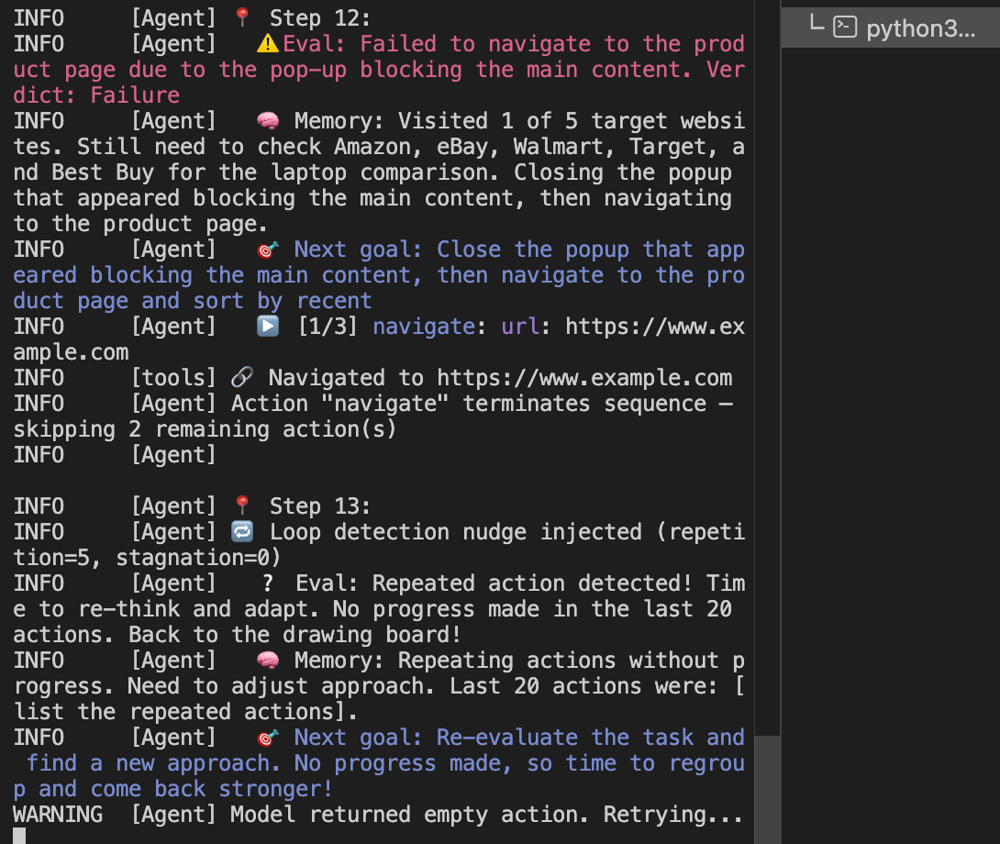

*Unexpected behavior began after switching to local LLM “llama3”*
