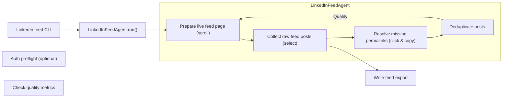
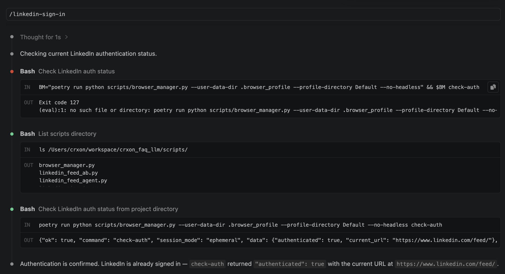
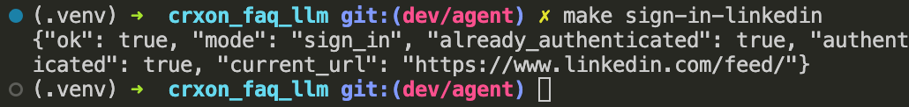
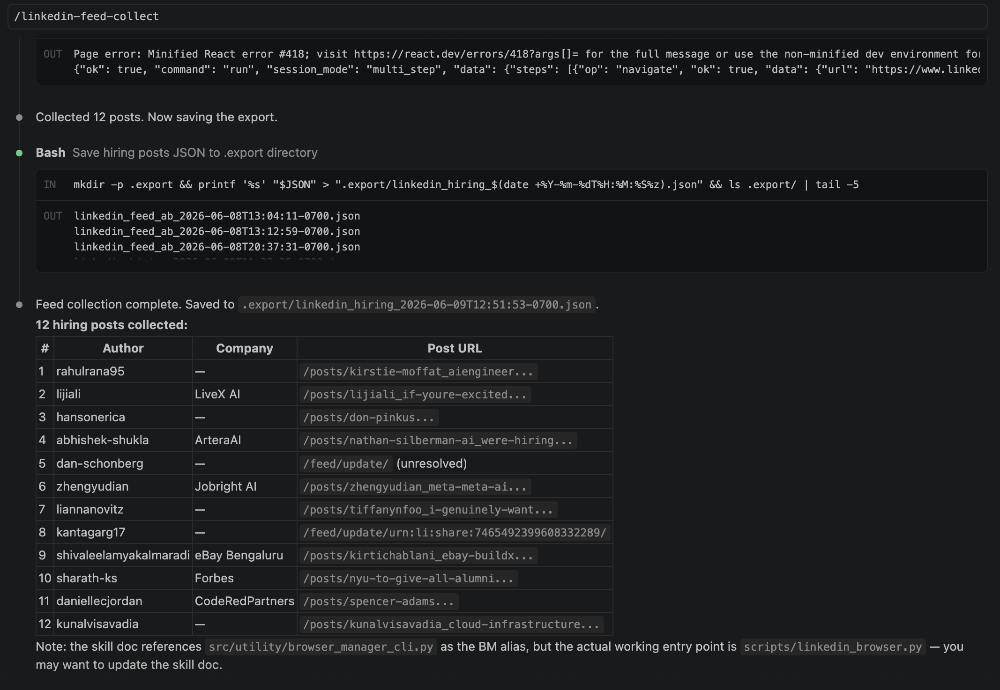
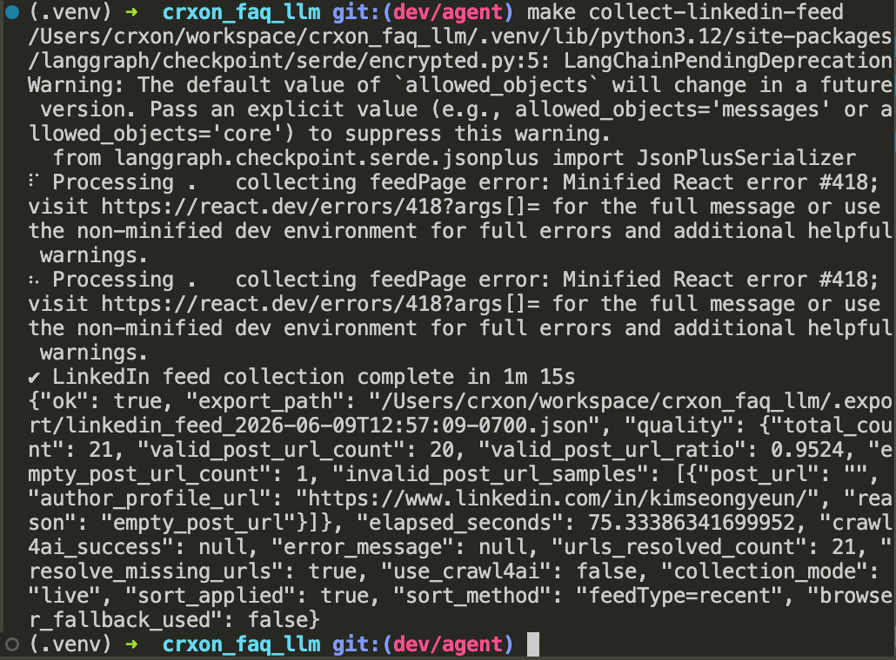

> 💡 This demo shows how a LinkedIn feed agent handles infinite scroll, lazy-loaded posts, and missing canonical URLs, then turns those posts into records that can be indexed and reused downstream.

See also: [Building a Web Agent for Authenticated Job Feeds](/posts/5c40cc27/).

- Goal: make LinkedIn home-feed collection reliable enough for downstream retrieval
- Core shift: move from passive scraping to interaction-aware collection

<!--more-->

---

## Problem

- In an earlier experiment, the agent collected only a small subset of the posts visible in the browser.
- LinkedIn home feed is an infinite-scrolling, lazily loaded surface.
- Additional posts appear only after scrolling and interaction.
- Many lazy-loaded feed posts do not expose a permanent link through straightforward selectors.
- Without a canonical URL, posts are much harder to index, deduplicate, retrieve later, or hand off to downstream agents.

---

## Why this matters

- **Retrieval quality:** posts without stable URLs are harder to store, rank, and fetch later.
- **Agent usability:** missing URLs weaken downstream workflows such as summarization, follow-up search, classification, and job-signal tracking.
- **Information density:** manual browsing and recommendation systems often miss the signals I care about most.
  - Example: I missed an early-May hiring wave for Forward Deployed Engineer roles at top AI companies and only recognized the pattern after many openings had already closed.
- **Collection quality matters more than raw token minimization** when the output must be reusable.

---

## Good to know: Tools vs. skills at a glance

- **Choose tools** when the agent needs to take concrete actions in the world: call APIs, query databases, write files, or interact with external systems.
- **Choose skills** when the agent needs reusable expertise that shapes *how* it approaches a task: domain heuristics, decision rules, workflow guidance, and tool-selection patterns.
- **Use both** in production systems: skills guide planning and judgment, while tools execute the actual work.
- A practical rule: use **tools for execution** and **skills for domain-specific judgment**.
- In this demo, sign-in, scrolling, link copying, and export fit best as tools; the logic for when to scroll again, when to resolve missing URLs, and how to validate collection quality fits better as a skill or agent routine.

---

## What agents need to understand

- A missing URL does **not** mean the post is unimportant.
- The page is dynamic, and additional content appears only after interaction.
- Scrolling is part of extraction in addition just navigation.
- Some useful metadata must be resolved through UI actions such as opening menus or copying links.
- Robust collection requires page interaction, not just HTML parsing.

> The agent must reason about browser behavior, not just page source.

---

## Why common approaches were not enough

- **Chat-based agents** such as OpenClaw or Hermes Agent are not a natural fit for authenticated browser automation with tools like Playwright or Crawl4AI.
- **Claude Code or Codex** can run the workflow, but they are not designed to stay active in the background with persistent, autonomous collection.
- I also wanted to **surface the live browser state during each run** so I could observe exactly where collection quality broke down.
- For deployment and serving, orchestration, sandboxing, and task scheduling also matter; direct messaging alone is not enough.

---

## Preparation

To make the workflow agent-friendly, I converted the Playwright/Crawl4AI flow into a CLI-style tool:

- Playwright and Crawl4AI behaviors are exposed through scripts and commands.
- Actions such as navigation, scrolling, clicking, and copying links can be triggered explicitly.
- Browser state and progress can be monitored from Claude Code through the CLI.
- This creates a cleaner separation between model reasoning and deterministic browser operations.

---

## Development Process

1. Observe the workflow lifecycle in browser (non-headless mode with Playwright and Crawl4AI)
2. Write CLI tools with helper functions in Python (assisted by Claude Code) based on workflow break-down
3. Refine, test and wrap the helper functions into an agent runnable from CLI

---

## Solution

### End-to-end flow

| Step | Module | What happens |
| --- | --- | --- |
| 1. Auth preflight | `linkedin_feed_agent.py` · `linkedin_auth.py` | When `check_auth=True` (default), opens the feed under profile lock and fails fast if the user is not signed in. |
| 2. Prepare feed | `linkedin_feed_collect.py` | Uses one `BrowserManager` session to navigate, wait for `mainFeed` and lazy-mount hydration, sort by Recent (menu JS with `?feedType=recent` fallback), then wait for cards to settle. |
| 3. Collect + resolve | `linkedin_feed_collect.py` | Runs in-browser JS to scroll and extract lazy-mounted cards; uses inline Send → Copy link for author-only stubs when `resolve_missing_urls=True` (default). Falls back to HTML parsing plus scroll recovery if JS cannot find the feed container. |
| 3b. Dedupe | `crawl4ai_linkedin_feed.py` | `dedupe_feed_posts()` collapses duplicate rows. |
| 4. Validate | / | `arm_quality_metrics()` measures how many records contain valid `post_url` permalinks. |
| 5. Export | `linkedin_feed_agent.py` | Writes `posts`, `valid_posts`, `quality`, and `params` (`collection_mode`, `sort_applied`, `sort_method`, and more) into `.export/`. |
| (Entrance) | `crawl4ai_linkedin_feed.py` | **Opt-in** (`--use-crawl4ai`): captures a virtual-scroll HTML snapshot for A/B testing. With `resolve_missing_urls=False`, crawl-only often returns zero useful posts. With resolution enabled, an empty crawl falls back to the live collection path above. |

---

### Diagram



---

## Result

### Skill “linkedin-sign-in”



### Agent run in CLI (`make sign-in-linkedin`)

```makefile
sign-in-linkedin:
	@poetry run python scripts/linkedin_sign_in.py \
    --user-data-dir .browser_profile --profile-directory Default
```



### Skill “linkedin-feed-collect”



### Agent run in CLI (`make collect-linkedin-feed`)

```makefile
collect-linkedin-feed:
	@poetry run python -m src.utility.linkedin_feed \
	--user-data-dir .browser_profile --profile-directory Default \
	--headless --max-posts 25 --scroll-rounds 50
```



---

## Demo takeaway

- A useful web agent cannot treat a dynamic feed like a static document.
- For LinkedIn home-feed collection, the agent must:
  - understand lazy loading;
  - interact with the page to reveal or resolve missing metadata;
  - recover stable URLs for indexing;
  - and produce outputs that are reusable for later retrieval, ranking, and downstream automation.
- The key shift is from **passive scraping** to **interaction-aware collection**.

---

## Appendix

[Skills vs Tools for AI Agents: Production Guide](https://www.arcade.dev/blog/what-are-agent-skills-and-tools/)
